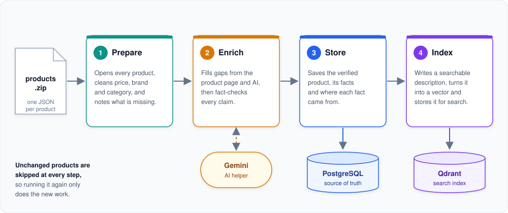
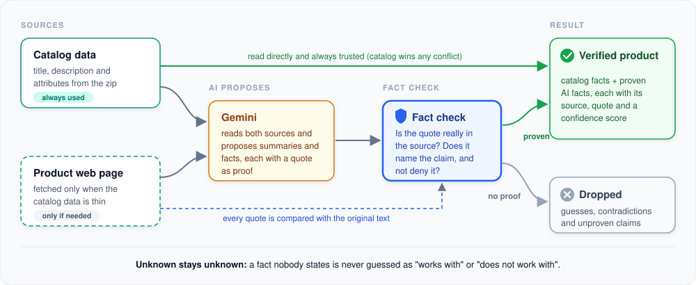
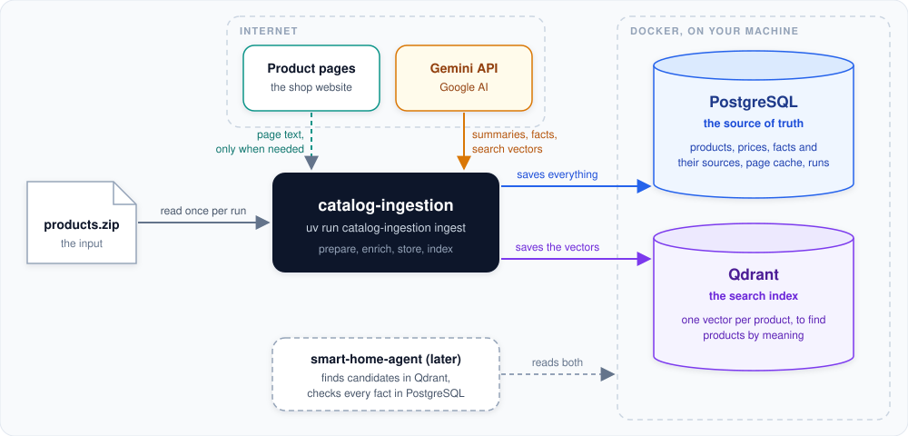

# How `ingest` works

`catalog-ingestion ingest` turns the raw product export (`products.zip`) into a clean, trustworthy catalog that the
HomePilot shopping agent can search and rely on.

```bash
uv run catalog-ingestion ingest
```

In one sentence: it **reads** every product, **fills in** missing information with help from the product page and
an AI model, **checks** everything the AI says against the original text, and **saves** the result in two places,
a database for facts and a search index for finding products by meaning.

---

## The run at a glance



**1. Prepare.** Each product in the zip is opened and tidied up: the price is read as a number, the brand is taken
from the title, the category comes from the shop URL, and the technical attributes are organized. Compatibility
facts that the catalog states clearly ("works with Alexa", "Zigbee") are picked out right away. Finally the
product gets a completeness check: is the description there? Are the attributes there? Does a smart device say
what it works with? This step needs no network and no AI.

**2. Enrich.** Many products have gaps. For those, the tool reads the product's own page on the shop website, and
then asks Gemini (Google's AI) to write short summaries in English and German, list key features and use cases,
and point out compatibility facts and requirements (for example "needs a hub"). The AI is useful but can make
things up, so nothing it says is accepted without proof. See [the next section](#how-a-product-gets-enriched).

**3. Store.** The verified product is saved in PostgreSQL, together with every fact and the place each fact came
from. PostgreSQL is the **source of truth**: prices, compatibility and requirements are always read from here.

**4. Index.** The tool writes a readable description of each product, turns it into a vector (a list of numbers
that captures its meaning) and stores it in Qdrant. This is what lets the agent find "a thermostat that works with
Apple Home" even if the customer's words do not match the catalog text exactly.

At the end, products that disappeared from the zip are marked as no longer available and removed from the search
index, and a summary table shows what happened.

---

## How a product gets enriched

The enrichment step is where most of the care goes. Its job is to add useful information **without ever inventing
facts**.



- **Catalog data is always the starting point,** and it wins every disagreement. If the catalog says a device does
  not support something, no AI answer can change that.
- **The product page is only fetched when the catalog data is thin,** and only that exact page is read: no
  browsing, no searching the web.
- **Gemini must prove every claim.** For each fact it proposes, it has to give a word-for-word quote from the
  catalog or the page.
- **The fact check** then looks for that quote in the original text. The claim survives only if the quote really
  exists, it actually names the thing being claimed, and it does not say the opposite ("nicht kompatibel mit ...").
  A quote about Siri can never become a claim about Apple Home.
- **Everything kept carries its origin:** where it came from (catalog, web page or AI), the exact supporting text,
  and a confidence score set by fixed rules, not by the AI.

The guiding rule is **unknown stays unknown**. When nobody says whether a product works with something, the
catalog records "unknown", never a guess in either direction. The agent can then be honest with the customer.

---

## Where the data lives



| Service | What it is for | Where it runs |
|---|---|---|
| **PostgreSQL** | The source of truth: products, prices, compatibility facts, requirements, where each fact came from, a cache of downloaded pages and a log of every run. | Docker, on your machine |
| **Qdrant** | The search index: one vector per product, used to find good candidates by meaning. It is never used to decide prices or compatibility. | Docker, on your machine |
| **Gemini API** | The AI helper: summaries and fact suggestions, reading pages the shop blocks for normal downloads, and creating the search vectors. | Google, over the internet |
| **Product pages** | Extra text for products whose catalog entry is thin. | The shop website |

Both databases are started with `docker compose up -d --wait` and keep their data between restarts. Later, the
smart-home-agent uses them together: it asks Qdrant for likely products, then checks every price and compatibility
fact in PostgreSQL before answering.

---

## Running it again

`ingest` is designed to be run as often as you like.

- **Only new work is done.** The tool remembers a fingerprint of every product, every AI answer and every search
  vector. If nothing changed, the step is skipped: a second run on the same zip makes no AI calls at all.
- **Nothing is lost when a run stops.** Each product is saved as soon as it is finished. After a crash, Ctrl-C or
  an AI quota limit, the next run simply continues with the products that are still missing.
- **Changed products are updated, removed products are retired.** A product that is no longer in the zip is marked
  as unavailable and taken out of the search index. As a safety net, the tool refuses to retire a large share of
  the catalog at once (for example after a truncated zip) unless you pass `--force`.
- **It still works without AI.** Without a Gemini key the catalog is built from the catalog data alone; only the
  AI summaries and the search index are missing, and the next run with a key adds them.

---

## Useful options

| Option | When to use it |
|---|---|
| `--limit 20` | Try the pipeline on the first 20 products (all Thomson radio modules, so no thermostats or hubs). |
| `--only-product ID` | Process one specific product (repeatable), e.g. the example set in the [main README](../../README.md#step-3-build-the-catalog). |
| `--skip-web` | Do not download any product pages. |
| `--skip-llm` | Do not call the AI (stored AI results are kept). |
| `--refresh-web` | Download product pages again even if they are cached. |
| `--force` | Ignore everything remembered and redo all the work. |

Related commands: `status` shows what is in both databases and how the last run went, and `reindex` rebuilds only
the search index from PostgreSQL (for example after changing the embedding model).

---

## For developers: where to look in the code

| Topic | Code |
|---|---|
| The command and its options | `src/catalog_ingestion/cli/ingest_command.py` |
| The order of the steps | `src/catalog_ingestion/pipeline/ingestion_pipeline.py` |
| Step 1: prepare | `src/catalog_ingestion/preparation/` (`ProductPreparer`) |
| Step 2: enrich and fact-check | `src/catalog_ingestion/enrichment/` (`ProductEnricher`, `web/`, `llm/`, `validation/`) |
| Step 3: store | `src/catalog_ingestion/database/` (`PostgresRepository`) |
| Step 4: index | `src/catalog_ingestion/indexing/` (`RetrievalDocumentBuilder`, `GeminiEmbedder`, `QdrantRepository`) |

The [README](../README.md) goes deeper into the database tables, the Qdrant payload, caching rules and
configuration.
