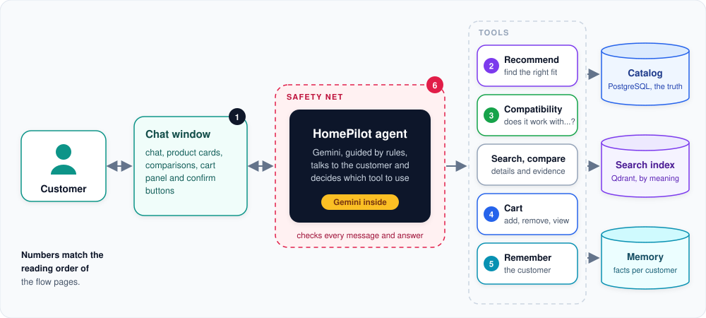

# HomePilot agent: how it works

HomePilot is a shopping assistant for smart home products. A customer chats with it in English or German, and it
recommends products, answers "does this work with my setup?", compares options and fills the shopping cart,
always based on the real catalog data.

These pages explain the main flows at a high level, one flow per page, each with one picture.

**In one paragraph:** the customer types in the chat window. The HomePilot agent (Gemini, guided by fixed rules)
reads the message and decides which **tool** to use. The tools do the real work in code: they read the product
catalog, search it by meaning, change the cart or remember the customer. Gemini only writes the answer from what the
tools return. A **safety net** checks every message before the AI sees it and every answer before the customer does.

## The flows

| # | Page | The question it answers |
|---|---|---|
| 1 | [One conversation turn](conversation-turn.md) | What happens between "send" and the answer on screen? |
| 2 | [Product recommendation](product-recommendation.md) | How does "I need a thermostat for Apple Home" become a trustworthy suggestion? |
| 3 | [Compatibility check](compatibility.md) | How does the agent decide whether a product works with the customer's setup? |
| 4 | [Shopping cart](shopping-cart.md) | How do products get into the cart, and why does the customer always confirm? |
| 5 | [Customer memory](customer-memory.md) | What does the agent remember about a customer, and what does it refuse to remember? |
| 6 | [Safety net](guardrail.md) | How are risky questions and wrong answers caught? |

Read them in order, or jump straight to the one you need; each page links to the next.

## How the agent reads the catalog

A closer look at how the AI gets its facts from the two databases.

| Page | The question it answers |
|---|---|
| [How the agent looks things up (RAG)](rag.md) | How does an AI that knows nothing about the shop answer with real catalog data? |
| [Search by meaning (Qdrant)](semantic-search.md) | How does "something to keep the living room warm" find thermostats? |
| [When the agent uses PostgreSQL](catalog-database.md) | Which feature reads which database, and why is PostgreSQL the source of truth? |

## Three promises behind every flow

- **Facts come from the catalog, not from the AI.** Prices, compatibility and requirements are read from the
  catalog database every time. The AI chooses words, never facts.
- **Unknown stays unknown.** If the catalog does not say whether something works, the agent says it cannot
  confirm it. It never guesses "yes" and never guesses "no".
- **The customer stays in control.** Nothing enters the cart without a click on "Confirm", and only what the
  customer says about themself is remembered.

## Where the data comes from

The catalog is built by the separate `catalog-ingestion` tool, which reads the product export, checks every fact
and fills the two databases this agent reads. See
[How ingest works](../../catalog-ingestion/docs/ingest-process.md).

## Deep dives

- [Upselling in HomePilot](upselling.md): the upgrade rules and how the business KPI is measured.
- [How the safety check understands messages](guardrail-embeddings.md): embeddings, example sentences, and how
  the safety net was tuned.
- [Known issues](known-issues.md): open problems found in testing, with reproduction, cause and proposed fix.
- The project [README](../README.md): setup, configuration, tools and tests.

---

[Next: One conversation turn &rarr;](conversation-turn.md)
