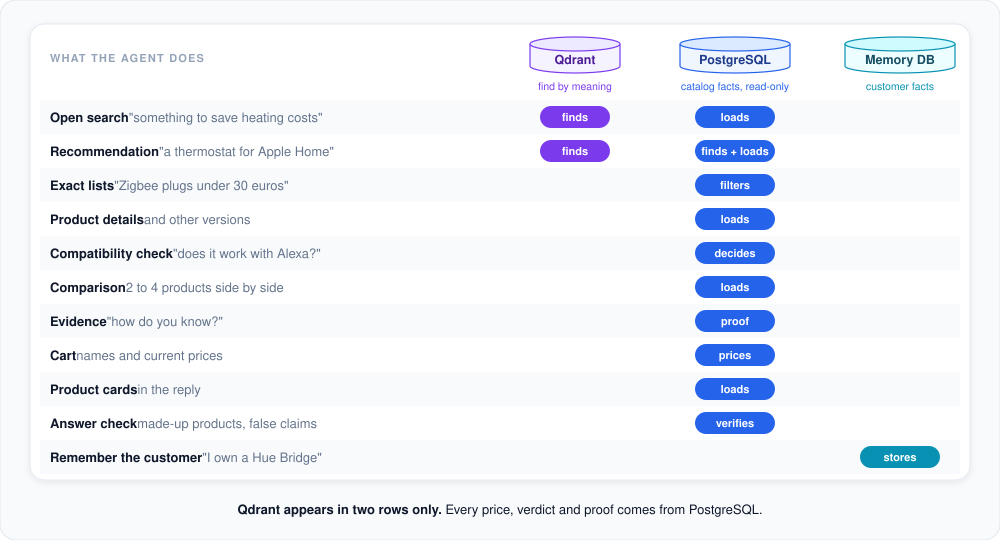

# When the agent uses PostgreSQL

Qdrant helps the agent *find* products. PostgreSQL is where the agent *knows* things: every price, every
compatibility verdict, every piece of proof. This page shows which feature reads which database.

**In short:** Qdrant is used by two features only. Everything else, and every fact the customer sees, is read from
the PostgreSQL catalog. A separate small database stores what customers tell the agent about themselves.

## What PostgreSQL does, feature by feature

- **Loads** the products that the search by meaning found, so titles and prices are always current.
- **Finds** products by exact criteria: category, price range, brand and confirmed systems ("Zigbee plugs under 30
  euros", sorted by price). Only active products are ever returned.
- **Decides compatibility** from stored facts: each fact says which system, whether it is supported, where it came
  from and the exact text that proves it. See [Compatibility check](compatibility.md).
- **Provides proof** when the customer asks "how do you know?": the source, the verbatim text and how confident the
  catalog is.
- **Prices the cart**: the cart only remembers product ids and quantities; names and prices are read again every
  time it is shown.
- **Fills the product cards** after the answer is written, and **verifies the answer** before it is shown.
- **Finds other versions** of a product (colors, sizes, packs) by its title.

## What is stored there

The catalog is built by `catalog-ingestion`:

| Data | Used for |
|---|---|
| Products: title, brand, category, product type, price, completeness | Filtering, cards, ranking |
| Compatibility facts: system, supported / not supported, source, proof, confidence | The compatibility verdict and "how do you know?" |
| Requirements: hub, app, network, professional installation, with alternatives | Required hubs and warnings |
| The original catalog entry | Product versions, attribute lookups ("Schutzart?") |

## Ground rules

- **Read-only.** The agent's connection to the catalog cannot change anything; only `catalog-ingestion` writes it.
- **The source of truth.** If Qdrant and PostgreSQL ever disagree, PostgreSQL wins; Qdrant is only asked for ids.
- **Same server, separate memory.** Customer memory lives in its own database on the same PostgreSQL server, the
  only place the agent writes to. See [Customer memory](customer-memory.md).
- **No SQL from the AI.** Gemini never writes queries; tools call fixed, tested code that builds them.

## For developers: where to look

| Topic | Code |
|---|---|
| Catalog reads (read-only connection) | `src/smart_home_agent/repositories/catalog/` (`CatalogRepository`) |
| Filters to SQL | `src/smart_home_agent/repositories/catalog/_product_query.py` |
| Rows to business models | `src/smart_home_agent/repositories/catalog/_product_mapper.py` |
| Schema (owned by the ingestion) | `catalog-ingestion/src/catalog_ingestion/database/records/` |
| Customer memory database | `src/smart_home_agent/repositories/profile/` |

---

[&larr; Search by meaning](semantic-search.md) | [Overview](README.md)
