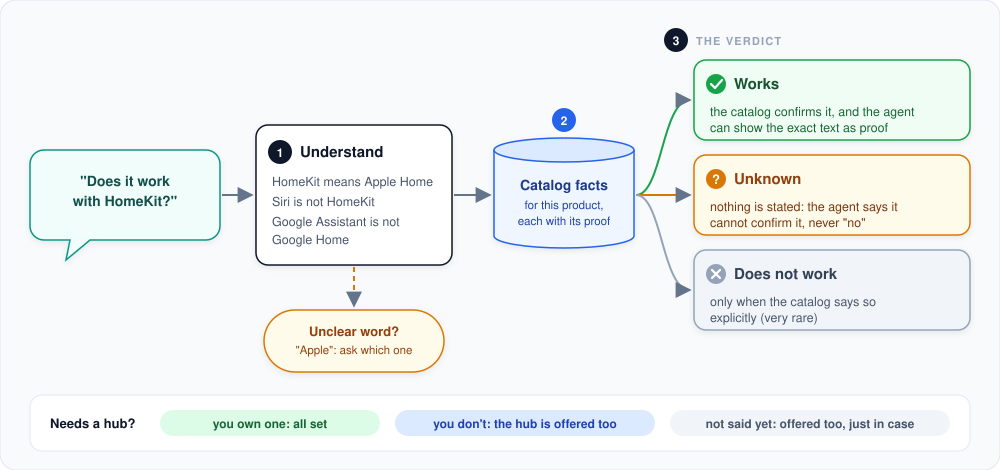

# Compatibility check

How the agent decides whether a product works with the customer's setup, for example "does it work with HomeKit?"
or "I use Alexa and Zigbee".

**In short:** the customer's words are translated into precise catalog terms, the product's stored facts are looked
up, and the answer is one of three verdicts: works, unknown or does not work. The AI never makes this decision;
code does.

**1. Understand the words.** Customers use many names for the same thing: "HomeKit", "Apple Home", "Home-App". They
are all mapped to one precise term. Things that sound alike stay apart: Siri is a voice assistant, not the Apple
Home system; Google Assistant is not Google Home; Matter is a standard, not a radio protocol. When a word is
ambiguous ("Apple", "Google"), the agent asks which one the customer means instead of guessing.

**2. Look up the facts.** Every product in the catalog has compatibility facts, each with its source and the exact
text that proves it. These facts were checked when the catalog was built.

**3. The verdict.**
- **Works:** the catalog confirms it, and the agent can show the proof when asked ("how do you know?").
- **Unknown:** the catalog does not say. The agent says "I can't confirm that", never "it does not work". This is
  by far the most common case for missing information.
- **Does not work:** only when the catalog explicitly says so. This is rare: the whole catalog has just a handful
  of such statements.

When several things are asked for at once, a product only counts as working if all of them are confirmed.

## Does it need a hub?

Many devices only work through a hub, gateway or bridge. The check reports this separately from the verdict:

- **You own one:** all set.
- **You don't:** the matching hub from the catalog is offered, with the bundle total.
- **Not said yet:** the hub is offered too, just in case, and the agent asks.

Other requirements (an app, a Wi-Fi network, professional installation) are mentioned as information.

## Why "unknown" matters

Most catalog entries simply do not list every system a product works with. Turning "not listed" into "not
compatible" would wrongly scare customers away; turning it into "compatible" would sell products that may not work.
Saying "I can't confirm it" is the honest answer, and it is the rule everywhere in HomePilot.

## For developers: where to look

| Topic | Code |
|---|---|
| The tool the agent calls | `src/smart_home_agent/tools/compatibility/` |
| Words to precise terms | `src/smart_home_agent/services/vocabulary/` (built on the catalog-ingestion vocabulary) |
| The verdict | `src/smart_home_agent/services/compatibility/` (`CompatibilityEvaluator`) |
| Proof for a fact | `src/smart_home_agent/services/evidence/` |

---

[&larr; Product recommendation](product-recommendation.md) | [Overview](README.md) | [Next: Shopping cart &rarr;](shopping-cart.md)
