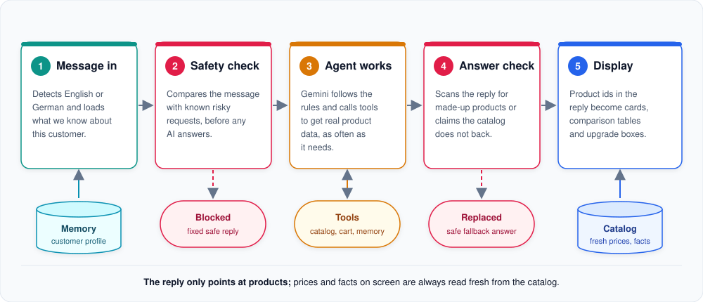

# One conversation turn

What happens between the moment the customer presses "send" and the moment the answer appears.

**In short:** the message is prepared, checked for safety, answered by the agent with the help of tools, checked
again, and finally turned into a rich answer with product cards built from fresh catalog data.

**1. Message in.** The agent detects whether the message is English or German, so the reply uses the same language
even though the catalog text is German. If the customer has been here before, what we know about them (their hub,
their voice assistant, their name) is loaded from the [customer memory](customer-memory.md).

**2. Safety check.** Before any AI is involved, the message is compared with examples of risky requests. Questions
about wiring or mains electricity, and attempts to override the agent's instructions, get a fixed, safe reply
straight away. Everything else passes. More in [Safety net](guardrail.md).

**3. Agent works.** Gemini reads its rules and the conversation, then calls the tools it needs: recommend products,
check compatibility, compare, look up evidence, change the cart or remember a fact. It may call several tools in
one turn. The tools return real catalog data, and Gemini writes the answer from that data only.

**4. Answer check.** The finished answer is tested before the customer sees it: does it mention a product that does
not exist? Does it claim a product works with something the catalog does not confirm? Does it explain wiring steps
or drift off topic? If so, a safe fallback answer replaces it.

**5. Display.** The answer does not contain prices or product details itself, only markers that point at products
("show this product", "compare these three"). The chat window turns them into product cards, comparison tables,
compatibility boxes and upgrade suggestions, reading every price and fact fresh from the catalog.

## Good to know

- **One turn at a time.** A conversation handles one message (or one cart confirmation) at a time, so two quick
  clicks never mix up the state.
- **Short hiccups are hidden.** If Gemini returns an empty answer or only says "let me look that up" without doing
  it, the request is retried automatically. Only if every retry fails does the customer see a friendly notice.
- **The conversation remembers context.** Within one conversation the agent keeps track of the category, budget and
  products discussed, so "and the cheaper one?" still makes sense.

## For developers: where to look

| Topic | Code |
|---|---|
| The turn itself | `src/smart_home_agent/agent/` (`AgentService`, `_turn_runner.py`) |
| Language detection | `src/smart_home_agent/session/language/` |
| The agent's rules | `src/smart_home_agent/agent/prompts/` |
| Retries of empty answers | `src/smart_home_agent/agent/model/` |
| Product markers to cards | `src/smart_home_agent/services/rich_content/`, `src/smart_home_agent/ui/components/` |

---

[&larr; Overview](README.md) | [Next: Product recommendation &rarr;](product-recommendation.md)
