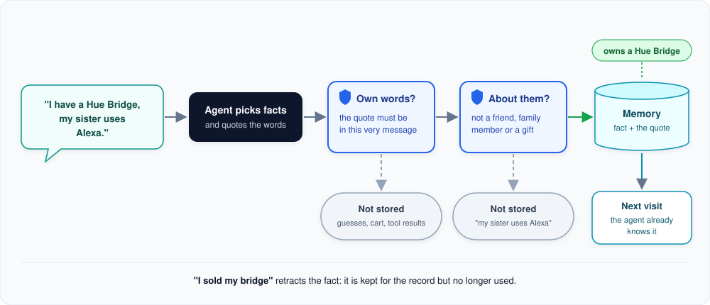

# Customer memory

What the agent remembers about a customer between conversations, and what it refuses to remember.

**In short:** when a customer says something lasting about themself ("I have a Hue Bridge", "I use Alexa", "call
me Anna"), the agent stores it together with the customer's own words. Two checks in code make sure nothing is
stored that the customer did not actually say about themself.

**1. The customer says something.** For example: "I have a Hue Bridge, my sister uses Alexa."

**2. The agent picks the facts** it wants to remember and quotes the exact words that support each one.

**3. Own words?** The quote must appear in the customer's current message. So the agent can never store a guess,
a product from the cart or something a tool returned as if the customer owned it.

**4. About them?** Statements about other people are refused: friends, family, colleagues or gifts. "My sister uses
Alexa" is not stored; "I have a Hue Bridge" is.

**5. Stored, and used next time.** The fact is saved for this customer with the quote as proof. In every later
conversation the agent already knows it and can say "since you have a Hue Bridge, this one fits your setup".

## What can be remembered

Name, preferred language, the systems and voice assistants the customer uses, devices and hubs they own, and simple
preferences. Hubs are stored in the same precise terms the catalog uses, so they can be matched to products.

## Changing and forgetting

- **"I sold my bridge"** retracts the fact. It is kept for the record but no longer shown to the agent.
- **A new name or language** replaces the old one.
- **Memory is context, not a decision.** Stored facts help the agent ask better questions; they are never silently
  used as filters. If the customer is shopping for someone else, their own setup does not get in the way.
- **Memory never blocks a conversation.** If it cannot be loaded, the chat simply continues without it.

## For developers: where to look

| Topic | Code |
|---|---|
| The tool the agent calls | `src/smart_home_agent/tools/profile/` |
| The two checks and retractions | `src/smart_home_agent/services/profile/` (`ProfileService`) |
| Storage and migrations | `src/smart_home_agent/repositories/profile/` |
| Loading the profile each turn | `src/smart_home_agent/agent/_profile_loader.py` |
| Picking a test customer | the "Customer" picker in the chat window, or `chat --user ID` |

---

[&larr; Shopping cart](shopping-cart.md) | [Overview](README.md) | [Next: Safety net &rarr;](guardrail.md)
