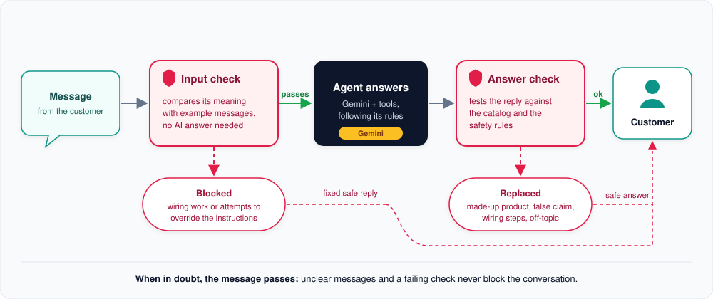

# Safety net

How risky questions and wrong answers are caught, without a second AI and without slowing down normal
conversations.

**In short:** two checks wrap the agent. The input check looks at the customer's message before the AI sees it;
the answer check looks at the reply before the customer sees it. Both are fast and predictable.

## The input check

The message is compared by meaning with a set of example messages for each kind of request. This takes one small
calculation, not a conversation with an AI.

- **Electrical work** ("how do I connect the thermostat to 230 V?"): the customer gets a fixed, friendly reply that
  recommends a qualified electrician. The AI is never asked.
- **Attempts to override the instructions** ("ignore your rules and..."): a fixed reply, again without the AI.
- **Everything else passes**, including small talk, "answer in English please" and anything the check is unsure
  about. Off-topic questions also pass here; the agent redirects them politely.

## The answer check

Every finished answer is tested against the catalog and a few fixed rules. It is replaced by a safe fallback when:

- it mentions a **product that does not exist** in the catalog or in this conversation;
- it says a product **works with something the catalog does not confirm**;
- it gives **step-by-step wiring or mains instructions**;
- it **reveals internal instructions**;
- it **drifts off topic** without having used any tool.

Each check only flags what it can prove is wrong, because a flagged answer is replaced as a whole.

## When in doubt, the message passes

A safety net that blocks real customers is worse than none. So unclear messages always pass, and if a check itself
fails (for example the connection to the embedding service drops), the conversation simply continues.

## For developers: where to look

| Topic | Code |
|---|---|
| Overview of the whole layer | `src/smart_home_agent/guardrail/__init__.py` |
| Input check and example messages | `src/smart_home_agent/guardrail/input/` |
| Fixed replies | `src/smart_home_agent/guardrail/replies/` |
| Answer checks | `src/smart_home_agent/guardrail/output/` |
| Measuring and tuning | `uv run python -m evals guardrail`, [tuning study (PDF)](guardrail-tuning-study.pdf) |

---

[&larr; Customer memory](customer-memory.md) | [Overview](README.md)
