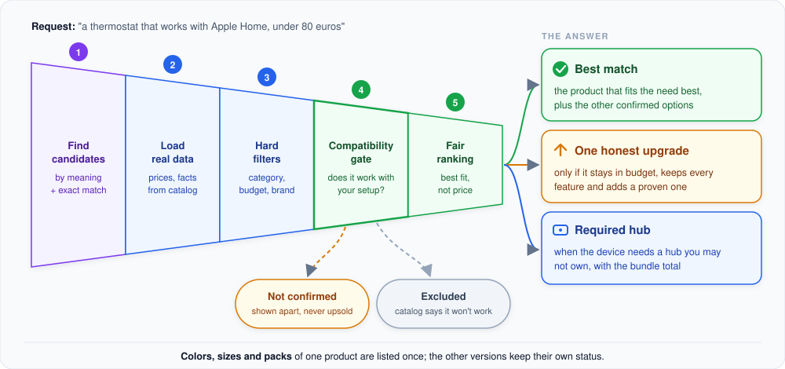

# Product recommendation

How a request like "a thermostat that works with Apple Home, under 80 euros" becomes a suggestion the customer can
trust.

**In short:** the agent hands the request to one tool that runs a fixed pipeline in code. Many products go in, and
the pipeline narrows them down step by step. What comes out is the best match, at most one honest upgrade and, if
needed, the hub that makes it work.

**1. Find candidates.** Two searches run side by side: a search by meaning (so "keeps my living room warm" finds
thermostats) and an exact search in the catalog (so a product that matches every requirement is never missed just
because its description is worded differently).

**2. Load real data.** Every candidate is loaded from the catalog database. From here on only these values count:
price, category, compatibility facts, requirements.

**3. Hard filters.** Wrong category, over budget or the wrong brand: out. A product with an unknown price never
passes a budget.

**4. Compatibility gate.** Each product is checked against what the customer asked for (see
[Compatibility check](compatibility.md)):
- **confirmed**: the catalog confirms everything that was asked for, so it can be recommended;
- **not confirmed**: something is simply not stated, so the product is shown separately, clearly labelled, and
  never used as an upgrade;
- **excluded**: the catalog explicitly says it does not work.

**5. Fair ranking.** Confirmed products are ranked by how well they fit the need: relevance, the right product type,
complete data and confirmed features. **Price plays no part**, so the best match is never the most expensive one by
design. A product that works with a hub the customer already owns gets a small bonus.

## What the customer gets

- **Best match**, plus the other confirmed options, so cheaper valid choices are never hidden.
- **One honest upgrade**, only when a pricier product stays within the budget, keeps every feature of the best
  match, adds at least one proven extra and needs no extra hub. The reasons ("also supports Matter") are computed from
  the catalog, not written by the AI. Details in [Upselling in HomePilot](upselling.md).
- **Required hub**: when a device only works with a hub the customer does not own (or has not mentioned), that hub
  is offered with the total price of the bundle, even if the total goes over the budget.

## Product versions

The shop lists every color, size or pack of a product as its own entry. The recommendation shows each product once
(its best version) and lists the other versions with their own status, for example "the white version is confirmed,
the 3-pack is over budget". A version of the best match is never offered as its upgrade.

## For developers: where to look

| Topic | Code |
|---|---|
| The tool the agent calls | `src/smart_home_agent/tools/recommendation/` |
| The pipeline | `src/smart_home_agent/services/recommendation/` (`RecommendationService`, `Ranker`, `UpsellSelector`) |
| Candidate search | `src/smart_home_agent/services/retrieval/` |
| Required hubs | `src/smart_home_agent/services/accessories/` |
| Product versions | `src/smart_home_agent/repositories/catalog/_product_mapper.py` |
| Upsell measurement | `uv run python -m evals upsell` |

---

[&larr; One conversation turn](conversation-turn.md) | [Overview](README.md) | [Next: Compatibility check &rarr;](compatibility.md)
