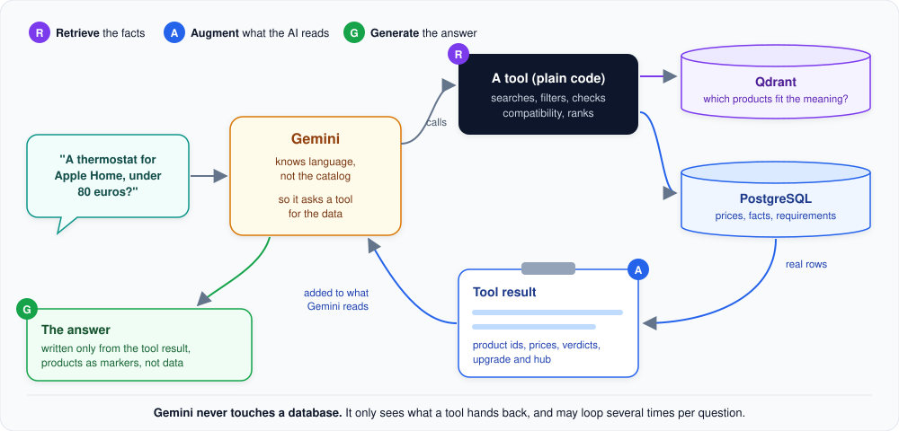

# How the agent looks things up (RAG)

Gemini is good with language, but it knows nothing about this shop's catalog: not the products, not today's prices,
not which thermostat works with Apple Home. This page explains how HomePilot gives it the facts it needs, a pattern
called **RAG** (retrieval-augmented generation).

**In short:** before answering, the agent calls a tool. The tool looks up the real data in the databases and hands it
back. Gemini then writes its answer from that data, and only from that data.

## The three letters

- **R, retrieve.** Gemini decides that it needs data and calls a tool, for example "recommend products for: thermostat,
  Apple Home, under 80 euros". The tool is plain code. It searches, filters, checks compatibility and ranks, using
  Qdrant to find products by meaning and PostgreSQL for every fact.
- **A, augment.** The tool's result (product ids, titles, prices, compatibility verdicts, the upgrade and the required
  hub) is added to the conversation that Gemini reads. Gemini's knowledge for this answer is now "augmented" with
  real catalog data.
- **G, generate.** Gemini writes the answer in the customer's language, using only what the tool returned. Products
  appear in the answer as markers ("show product 22893310"), and the chat window fills in names and prices from the
  catalog itself.

Gemini may go around this loop several times for one question. For "compare the two cheapest Zigbee thermostats", it
can first list the thermostats, then compare two of them.

## How this differs from "classic" RAG

Many RAG systems cut documents into text snippets, search the snippets and paste the best ones into the prompt.
HomePilot works differently, because a shop catalog is structured data, not prose:

| Classic RAG | HomePilot |
|---|---|
| Retrieves text snippets | Retrieves whole products with typed fields: price, category, compatibility facts, requirements |
| The search result *is* the context | The search only finds candidates; every fact is then read from PostgreSQL |
| The AI judges whether a snippet answers the question | Code decides compatibility, filters and ranking; the AI explains the result |
| One search per question | The AI chooses among several tools and may call more than one |

The advantage: the facts in an answer cannot drift from the catalog. A price comes from the price column, and "works
with Apple Home" comes from a stored fact with its proof, not from a sentence the AI summarized.

## What keeps the AI honest

- **No database access for the AI.** Gemini can only call the tools it is given; it never writes a query.
- **Rules in the prompt:** facts only from tools, "unknown stays unknown", never invent advantages.
- **Checks in code:** the [answer check](guardrail.md#the-answer-check) compares every product and compatibility claim
  in the reply with the catalog before the customer sees it.
- **Data, not prose, on screen:** product cards, comparisons and cart lines are built from PostgreSQL after the
  answer is written, so a wrong price in the AI's wording can never reach a card.

## Read next

- [Search by meaning (Qdrant)](semantic-search.md): how "something to keep the living room warm" finds thermostats.
- [When the agent uses PostgreSQL](catalog-database.md): which feature reads which database.

## For developers: where to look

| Topic | Code |
|---|---|
| The tools the AI can call | `src/smart_home_agent/tools/` (`ToolRegistry`) |
| The rules in the prompt | `src/smart_home_agent/agent/prompts/` |
| Markers to product cards | `src/smart_home_agent/services/rich_content/`, `src/smart_home_agent/answer_tags/` |

---

[&larr; Overview](README.md) | [Next: Search by meaning &rarr;](semantic-search.md)
