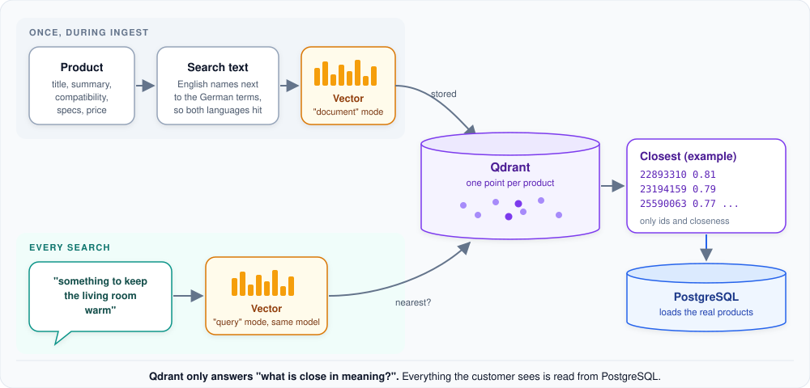

# Search by meaning (Qdrant)

How a vague request like "something to keep the living room warm" finds radiator thermostats, even though none of
those words appear in their titles.

**In short:** every product has a vector, a list of numbers that captures what it is about. The customer's request
gets a vector too. Qdrant returns the products whose vectors are closest: only their ids and how close they are.
Everything else is then loaded from PostgreSQL.

## Once, during ingest

The `catalog-ingestion` tool writes a short **search text** for every product: title, brand, category, the summary,
key features, the systems it works with, requirements, specs and price. English names stand next to the original
German terms ("Door and window sensor (Tür- & Fensterkontakt)"), so a query in either language finds it.

Gemini turns that text into a **vector** of 768 numbers in "document" mode, and Qdrant stores one point per product.
Details in [How ingest works](../../catalog-ingestion/docs/ingest-process.md).

## On every search

1. **The request becomes a vector.** The same Gemini embedding model is used, in "query" mode, which is tuned for
   short questions matching longer documents. Using the same model on both sides is essential: the agent checks it
   when it starts, and the `check` command reports it.
2. **Qdrant finds the nearest points.** It compares the request vector with every product vector and returns the
   closest ones with a closeness score (1 = same meaning). When the category is already clear, Qdrant only looks in
   that category, which makes the search sharper.
3. **Only ids come back.** Qdrant is asked for product ids and scores, nothing else. Prices or compatibility stored
   next to the vectors are never used.
4. **PostgreSQL loads the products.** Titles, prices and facts are read from the catalog database, which also
   re-checks the category.

## Two ways the agent uses it

- **Open search** ("something to save heating costs"): up to 20 products by meaning. The agent presents them as
  ideas, not as confirmed fits, because a close meaning says nothing about compatibility.
- **Recommendation** ("a thermostat for Apple Home under 80 euros"): the 50 closest products are combined with an
  **exact search in PostgreSQL** (same category, budget, brand and confirmed systems). A product that matches every
  requirement is never lost just because its description is worded differently; it still gets a closeness score,
  which counts in the ranking. The [recommendation funnel](product-recommendation.md) then filters and ranks them.

## Why not search PostgreSQL only?

Exact search only finds what the customer names precisely. Customers describe needs ("keep the room warm", "know if
a window is open"), not product categories. Search by meaning bridges that gap, in English and German. Exact search
guarantees that nothing matching the hard requirements is missed. Together they give both recall and precision.

## For developers: where to look

| Topic | Code |
|---|---|
| Qdrant queries (ids and scores only) | `src/smart_home_agent/repositories/semantic/` (`QdrantIndex`) |
| Semantic plus exact candidates | `src/smart_home_agent/services/retrieval/` (`RetrievalService`) |
| Open search tool | `src/smart_home_agent/tools/catalog/search_products_tool.py` |
| Candidate pool size | `AGENT_CANDIDATE_POOL` (default 50) |
| Query embeddings | `GeminiEmbedder.embed_query` in catalog-ingestion (shared with the index) |

---

[&larr; How the agent looks things up](rag.md) | [Overview](README.md) | [Next: When the agent uses PostgreSQL &rarr;](catalog-database.md)
