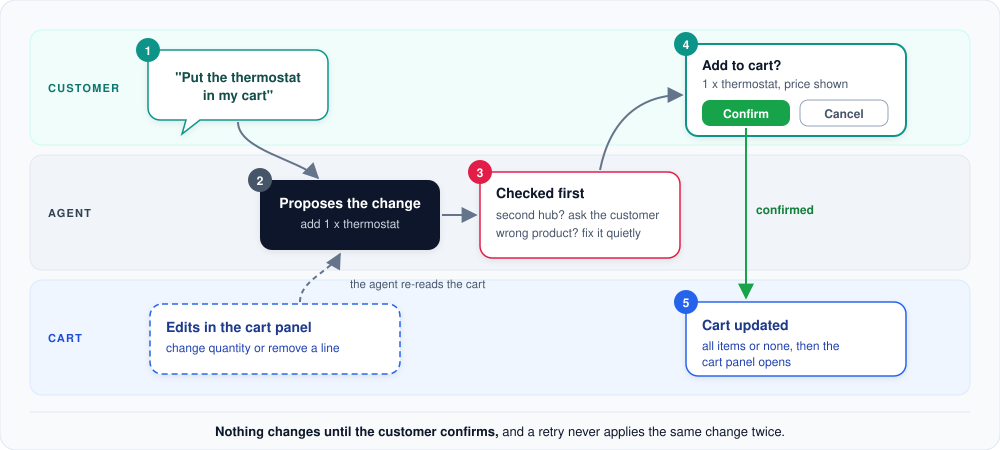

# Shopping cart

How products get into the cart and why the customer always has the last word.

**In short:** only the agent can add products, and only after the customer clicks "Confirm" on a card that shows
exactly what will change. The customer can adjust quantities or remove lines directly in the cart panel.

**1. The customer asks.** "Put the thermostat in my cart", or "add the bridge too".

**2. The agent proposes the change.** It prepares the change: which products, how many.

**3. Checked first.** Before the customer sees anything, the change is checked:
- **A second hub?** One home rarely needs two hubs or gateways. If the change would put more than one in the cart,
  no card appears; the agent asks the customer first.
- **A product that does not exist or is not in the cart?** The agent corrects itself quietly and tries again, so a
  wrong product never reaches the customer.

**4. The customer confirms.** A card shows the change with names and prices. Nothing has happened yet. Several
products in one request are confirmed together.

**5. The cart is updated.** All items of the change are applied, or none of them. The cart panel then opens so the
customer sees the result.

## Changes in the cart panel

The customer can change quantities or remove lines in the cart panel without asking the agent. The agent notices
that the cart was edited and looks at it again before talking about it, so it never works with an outdated cart.
Adding new products always goes through the agent.

## Good to know

- **Prices are always current.** The cart only stores which products and how many; names and prices are read from
  the catalog every time it is shown.
- **No double changes.** If something fails after a change was applied, retrying never applies it a second time.
- **Cancel means cancel.** A declined card changes nothing, and the agent is told so.

## For developers: where to look

| Topic | Code |
|---|---|
| Cart tools and the confirmation rule | `src/smart_home_agent/tools/cart/` |
| Applying changes, hub rule | `src/smart_home_agent/services/cart/` (`CartService`, `CentralUnit`) |
| Confirmations in a turn | `src/smart_home_agent/agent/` (`AgentService.confirm`, `_confirmation_ledger.py`) |
| Cart panel and confirmation card | `src/smart_home_agent/ui/components/` (`cart_html.py`, `confirmation_html.py`) |

---

[&larr; Compatibility check](compatibility.md) | [Overview](README.md) | [Next: Customer memory &rarr;](customer-memory.md)
